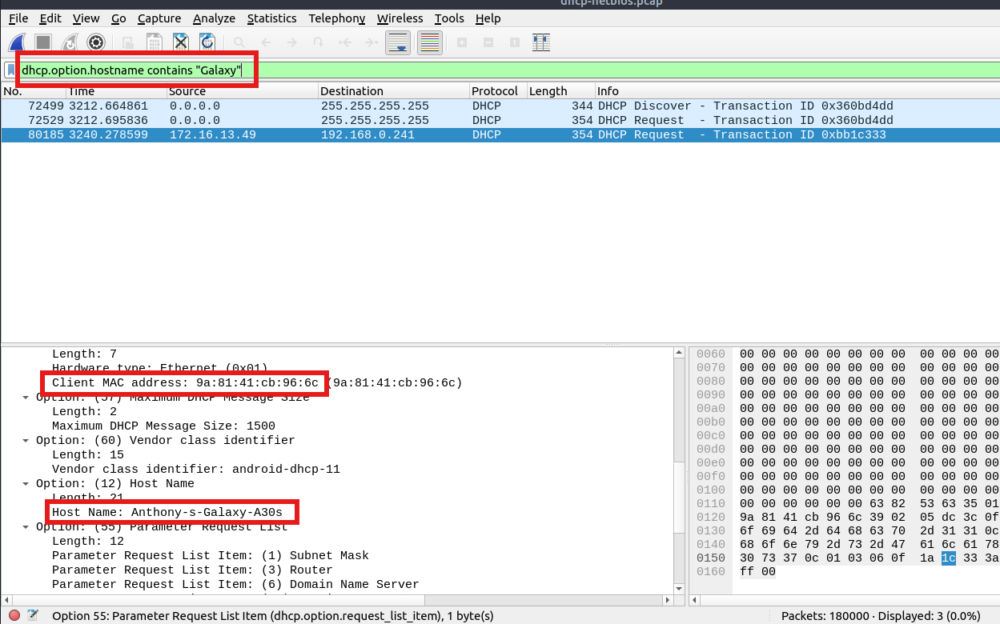
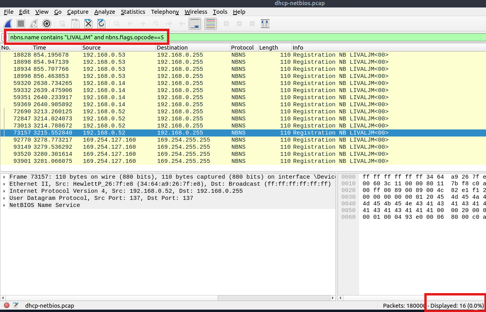
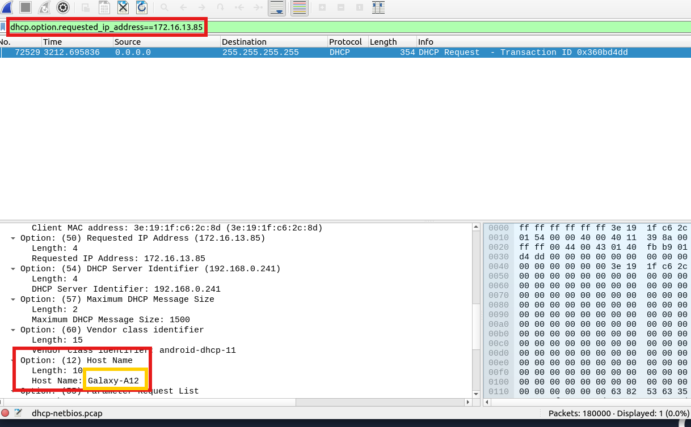
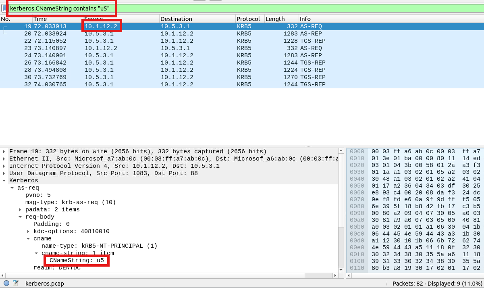
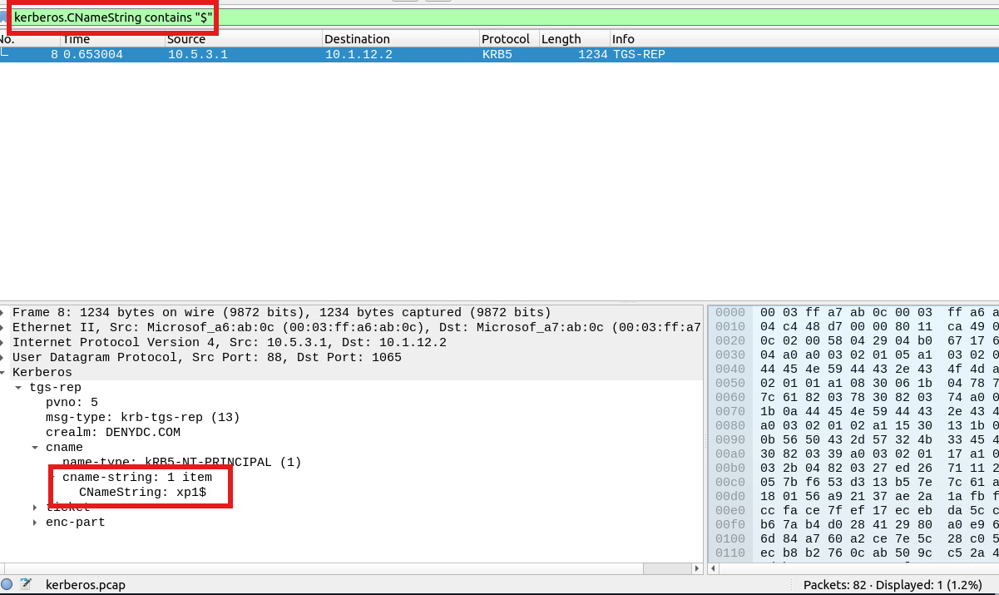

# Análisis de DHCP, NBNS y Kerberos mediante Wireshark

## Objetivo

En esta etapa se trabajó con el análisis de tráfico de red mediante Wireshark, utilizando filtros de visualización para identificar información relacionada con la asignación de direcciones IP, el registro de nombres NetBIOS y la autenticación mediante Kerberos.

El objetivo principal fue investigar diferentes protocolos presentes en una captura PCAP y extraer información relevante sobre los dispositivos, las solicitudes de configuración de red y las identidades observadas en los paquetes.

Para ello, se analizaron los siguientes protocolos:

- **DHCP (Dynamic Host Configuration Protocol):** permite asignar direcciones IP y proporcionar parámetros de configuración de red a los dispositivos.
- **NBNS (NetBIOS Name Service):** permite consultar y registrar nombres NetBIOS en redes que utilizan este servicio.
- **Kerberos:** protocolo de autenticación que permite verificar identidades y solicitar acceso a servicios dentro de entornos como Active Directory.

El análisis se realizó mediante filtros de visualización específicos, examinando los campos de los paquetes para responder preguntas concretas y relacionar la información obtenida con posibles tareas de investigación en un entorno SOC.

## Análisis realizado

Durante los ejercicios se utilizaron filtros de Wireshark para localizar nombres de dispositivos, solicitudes de registro NetBIOS, direcciones IP solicitadas mediante DHCP y nombres de cliente presentes en mensajes Kerberos.

Cada filtro permitió reducir el conjunto de paquetes analizados y facilitar la identificación de los datos necesarios para responder las preguntas del laboratorio.

## Evidencia

### 1. Identificación de la dirección MAC del host "Galaxy A30"

**Pregunta:** ¿Cuál es la dirección MAC del host "Galaxy A30"?

**Filtro utilizado:**

```wireshark
dhcp.option.hostname contains "Galaxy"
```

Este filtro permite localizar paquetes DHCP cuyo campo de nombre de host contiene la cadena `Galaxy`.

En DHCP, la dirección MAC puede encontrarse en el campo `Client MAC address` o en el campo correspondiente a la dirección de hardware del cliente, según el tipo de mensaje y los campos disponibles en la captura.




### 2. Identificación de solicitudes de registro NetBIOS

**Pregunta:** ¿Cuántas solicitudes de registro NetBIOS tiene la estación de trabajo "LIVALJM"?

**Filtro utilizado:**

```wireshark
nbns.name contains "LIVALJM" and nbns.flags.opcode == 5
```

Este filtro permite localizar paquetes NBNS cuyo nombre contiene `LIVALJM` y cuyo código de operación corresponde a una solicitud de registro de nombre.

El filtro combina dos condiciones:

- `nbns.name contains "LIVALJM"`: busca mensajes NBNS que contienen el nombre NetBIOS de la estación de trabajo.
- `nbns.flags.opcode == 5`: identifica mensajes cuya operación es el registro de un nombre NetBIOS.

El valor `5` corresponde a la operación de registro de nombre (*Name Registration*). Esta operación permite que un dispositivo solicite registrar un nombre dentro del entorno de red.




### 3. Identificación del host que solicitó una dirección IP mediante DHCP

**Pregunta:** ¿Qué host solicitó la dirección IP `172.16.13.85`?

**Filtro utilizado:**

```wireshark
dhcp.option.requested_ip_address == 172.16.13.85
```

Este filtro permite localizar paquetes DHCP que contienen la dirección `172.16.13.85` en el campo de dirección IP solicitada por el cliente.

El campo `dhcp.option.requested_ip_address` representa la dirección IP que el cliente DHCP solicita utilizar. Esta información puede aparecer, por ejemplo, durante el proceso de obtención o renovación de una dirección IP.




### 4. Identificación de la dirección IP asociada al usuario "u5"

**Pregunta:** ¿Cuál es la dirección IP del usuario "u5"?

**Filtro utilizado:**

```wireshark
kerberos.CNameString contains "u5"
```

Este filtro permite localizar paquetes Kerberos cuyo campo `CNameString` contiene el texto `u5`.

El campo `CNameString` representa el nombre del cliente Kerberos incluido en determinados mensajes de autenticación. En un entorno de Active Directory, ese valor puede corresponder al nombre de una cuenta de usuario o, en ciertos casos, a una cuenta de equipo.




### 5. Identificación del nombre de host presente en los paquetes Kerberos

**Pregunta:** ¿Cuál es el nombre de host disponible en los paquetes de Kerberos?

**Filtro utilizado:**

```wireshark
kerberos.CNameString contains "$"
```

Este filtro permite localizar paquetes Kerberos cuyo campo `CNameString` contiene el carácter `$`.

En entornos Windows con Active Directory, las cuentas de equipo (host) suelen terminar en `$`, mientras que las cuentas de usuario normalmente no utilizan ese sufijo.

Por ejemplo:

| Valor observado | Interpretación habitual |
|---|---|
| `u5` | Cuenta de usuario |
| `u1` | Cuenta de usuario |
| `xp1$` | Cuenta de equipo asociada habitualmente al host `XP1` |

Esta distinción resulta útil durante el análisis de Kerberos porque el campo `CNameString` puede contener tanto nombres de usuarios como nombres de cuentas de equipos.

Al aplicar el filtro, se localizaron los paquetes que contenían el sufijo `$`. En la captura analizada se identificó el valor `xp1$`, correspondiente a una cuenta de equipo. Por lo tanto, el nombre de host esperado en el ejercicio es `XP1`.




## Qué se aprendió

- Utilizar filtros DHCP para localizar dispositivos mediante el nombre de host.
- Identificar la dirección MAC de un cliente a partir de los campos correspondientes de un paquete DHCP.
- Reconocer solicitudes de registro de nombres NetBIOS mediante el campo `nbns.flags.opcode`.
- Diferenciar solicitudes NBNS de respuestas mediante el campo `nbns.flags.response`.
- Investigar direcciones IP solicitadas por clientes DHCP y distinguir una solicitud de una asignación confirmada.
- Utilizar el campo `kerberos.CNameString` para identificar nombres de clientes Kerberos.
- Diferenciar cuentas de usuario y cuentas de equipo mediante convenciones habituales de Active Directory.


## Evidencias adjuntas

- **Captura 1:** filtro DHCP para localizar el host "Galaxy A30" e identificar su dirección MAC.
- **Captura 2:** filtro NBNS para investigar solicitudes de registro de la estación de trabajo "LIVALJM".
- **Captura 3:** filtro DHCP para localizar la solicitud de la dirección IP `172.16.13.85`.
- **Captura 4:** filtro Kerberos para localizar al cliente `u5` y examinar la dirección IP asociada a la comunicación.
- **Captura 5:** filtro Kerberos para identificar la cuenta de equipo `xp1$` y distinguirla de las cuentas de usuario.